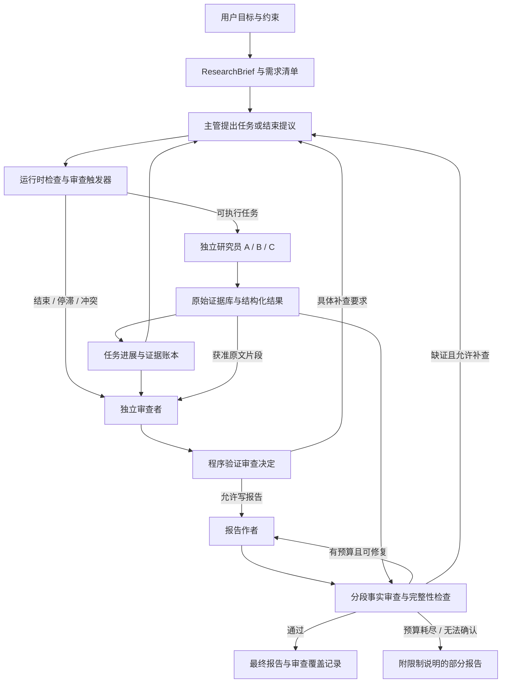

# Open Deep Research：独立审查与最小充分上下文设计

日期：2026-10-23。状态：**第一轮已实现（独立审查、统一上下文组装、受控记录层），通过离线测试与复现探针；真实付费集成待重跑，尚未测得性能提升。**

- 第一轮验收复核（修复前快照）：[ROUND1_ACCEPTANCE_REVIEW_2026-10-23.md](ROUND1_ACCEPTANCE_REVIEW_2026-10-23.md)
- 第一轮阻塞项修复记录（R1–R5）：[ROUND1_FIX_REPORT_2026-10-23.md](ROUND1_FIX_REPORT_2026-10-23.md)
- 路由审计：[ROUTING_AUDIT_2026-10-23.md](ROUTING_AUDIT_2026-10-23.md)、[FIX_REPORT_2026-10-23.md](FIX_REPORT_2026-10-23.md)

下方的“尚未实现”表述为设计阶段原文，保留作为设计意图记录。

目标项目：`~/open_deep_research`。本方案只涉及主实现 `src/open_deep_research/`，不迁移 legacy 工作流。本文中的模块名、接口、目录和参数均是待实现设计。

本次交付只新增设计文档；程序、提示词、依赖、测试和运行配置保持原样。核验时当前目录没有 `.git`，因此用 [baseline-files.json](baseline-files.json) 的 SHA-256 标识本地源码快照，不能把它当成某个已确认的上游 commit。

## 1. 建议采用的方案

保留现有 LangGraph 调度结构，增加三个相互配合的能力：

1. **独立审查者 Reviewer**：在主管准备结束、研究明显停滞和报告交付前检查目标、证据及结论。它每次从新的审查包开始，不继承主管的长对话。
2. **统一上下文组装器 ContextBuilder**：每次模型调用只装入该角色的职责、当前任务、必要证据和有限工作状态，同时筛选工具与说明。
3. **受控记录与读取层 ArtifactStore**：完整记录可以保存在磁盘；模型只通过身份绑定的接口读取获准片段。记录、授权、进入本次请求是三个独立步骤。

“尽可能精简”在这里解释为**最小充分上下文**：优先删除重复历史、无关规则和无关工具，不删除用户约束、反证、来源或尚未解决的问题。上下文少了但漏答增多，不算优化成功。

审查者也可能判断错误。它能改善证据检查与停止决策，不能保证消除幻觉。方案以原始证据、确定性检查、独立评测共同约束它。

阅读路径：

| 文档 | 解决的问题 |
| --- | --- |
| 本文 | 为什么这样改、角色关系、审查闭环 |
| [CONTEXT_AND_STORAGE.md](CONTEXT_AND_STORAGE.md) | 每个角色究竟看到什么、上下文怎样保存和读取 |
| [DYNAMIC_CONTEXT.md](DYNAMIC_CONTEXT.md) | 每轮怎样选择材料、上下文管理角色怎样介入、遗漏后怎样恢复和修正结论 |
| [IMPLEMENTATION_HANDOFF.md](IMPLEMENTATION_HANDOFF.md) | 修改入口、接口契约、实施顺序、验收场景 |
| [EVALUATION.md](EVALUATION.md) | 如何测出成本、延迟、质量的真实变化 |
| [SOURCES.md](SOURCES.md) | 论坛、开源代码与官方文档的学习顺序及证据边界 |

## 2. 当前代码已经做了什么，还缺什么

以下判断来自本次本地源码检查，而不是只根据项目介绍推断。

| 现状 | 源码入口 | 对本方案的影响 |
| --- | --- | --- |
| 主管已有固定的调度工具：`ConductResearch`、`ResearchComplete`、`think_tool` | [deep_researcher.py:202](../../src/open_deep_research/deep_researcher.py:202) | 主管就是主脑；新 Reviewer 是另一角色，不再增加一个调度主管 |
| 每次研究员调用只传任务文本和新消息列表；并行使用同一配置 | [deep_researcher.py:294](../../src/open_deep_research/deep_researcher.py:294) | 保留这种独立输入方式，升级为结构化任务卡 |
| 研究员用 `operator.add` 持续追加历史，每轮把历史加入模型请求 | [state.py:83](../../src/open_deep_research/state.py:83)、[deep_researcher.py:414](../../src/open_deep_research/deep_researcher.py:414) | 初始隔离不等于长期上下文受控；需要滑动工作集和可回读证据 |
| 每个研究员均调用 `get_all_tools(config)`，并注入配置中的 `mcp_prompt` | [utils.py:569](../../src/open_deep_research/utils.py:569)、[deep_researcher.py:400](../../src/open_deep_research/deep_researcher.py:400) | 工具和附加说明都要按任务过滤；不要只改消息历史 |
| 网页先按字符截断再摘要；摘要超时或失败会返回原文片段 | [utils.py:82](../../src/open_deep_research/utils.py:82)、[utils.py:175](../../src/open_deep_research/utils.py:175) | 单个工具结果仍可能很大；摘要前保存原始结果，失败时返回有上限的摘录和指针 |
| 研究结束才压缩；压缩超限后删历史；报告超限后按字符截断 findings | [deep_researcher.py:511](../../src/open_deep_research/deep_researcher.py:511)、[deep_researcher.py:607](../../src/open_deep_research/deep_researcher.py:607) | 将预算检查前置，并保留恢复被移出内容的能力 |
| `ResearchComplete`、无工具调用、迭代超限都能直接结束主管阶段 | [deep_researcher.py:246](../../src/open_deep_research/deep_researcher.py:246) | 结束信号应成为待审提议；超限与无工具调用不能证明研究充分 |
| 主管的异常分支包含 `or True`，各种异常都可能直接结束研究 | [deep_researcher.py:334](../../src/open_deep_research/deep_researcher.py:334) | 错误必须显式分类和传播，否则 Reviewer 可能看到缺失结果却以为已完成 |
| `get_notes_from_tool_calls()` 收集全部工具消息，包括 think 和错误文本 | [utils.py:599](../../src/open_deep_research/utils.py:599) | 区分事实证据、推断、工作笔记和错误；工具消息不天然等于证据 |
| `raw_notes` 混合研究员 AI 和工具消息；groundedness 以它作为依据 | [deep_researcher.py:554](../../src/open_deep_research/deep_researcher.py:554)、[evaluators.py:134](../../tests/evaluators.py:134) | 当前评分能检查与笔记的一致性，但不能单独证明与原始来源一致 |
| 主图直接 `.compile()`；现有评估脚本使用 `MemorySaver()` | [deep_researcher.py:719](../../src/open_deep_research/deep_researcher.py:719)、[run_evaluate.py:35](../../tests/run_evaluate.py:35) | 本地开发持久化与部署平台持久化要分别接入，不能假定已有永久磁盘记录 |

本地主实现没有自动扫描并注入所有 `AGENTS.md` / `SKILL.md` 的机制。这里也不建议为了“精简 Skill”先引入庞大的 Skill 系统。MVP 只需要角色规则文件，以及少量按任务可选的工具说明。

## 3. 角色和信息流



图中的运行时检查、证据库和上下文组装器是普通程序模块，不是新增 LLM agent。网页摘要器、研究压缩器、报告作者即使代码中叫“函数”，只要调用模型，也必须纳入上下文与成本管理。

| 角色 | 默认模型输入 | 默认工具 | 不自动进入该角色请求的内容 |
| --- | --- | --- | --- |
| 主管 Supervisor | 用户需求清单、任务状态、结果摘要、证据索引、未解决审查项、剩余预算 | 派发任务、提交结束提议、读取已发布结果片段 | 研究员完整搜索轨迹、其他角色规则、全部网页原文 |
| 研究员 Researcher | 当前任务卡、必要背景、自己已确认的发现、最近完整工具交互、获准证据 | 与任务匹配的搜索 / 抓取 / MCP 只读工具、读取授权证据、提交结果 | 主管完整历史、其他研究员私有日志、Reviewer 历史 |
| 审查者 Reviewer | 原始需求约束、待审决定、覆盖矩阵、来源摘录、冲突与遗漏、预算事实 | 读取审查范围内的证据原文和公开结果 | 主脑的长篇自我解释、无关历史、改写账本或派发任务的能力 |
| 报告作者 Writer | 需求、章节计划、已发布 claim/evidence、审查约束、明确未知项 | 读取写作范围内证据；MVP 不自行搜索 | 全部研究历史、重复搜索结果、调度细节 |
| 网页摘要器 / 压缩器 | 当前页面分块或本任务证据集合、提取目标、来源 ID | 无通用工具 | 其他任务、主管规则、全部 MCP 说明 |

Reviewer 可以读取被引用的原文和运行时独立纳入的冲突证据，避免只相信主管挑选的摘要。它看到的材料由程序从账本生成；主管不能删除不利记录再交审。审查者可提出补查，但补查仍由调度层创建新任务卡，不开放无边界的第二套研究循环。

## 4. 审查者具体审什么

把“过长幻觉”拆成可测问题：

- **事实失据**：结论没有来源，或引文不能支持该结论。
- **推断升级**：来源只给出可能性，报告却写成确定事实。
- **任务漂移**：不断研究旁支，没有满足用户的核心问题。
- **无效循环**：重复搜索、反复修订，但没有增加新的有效证据。
- **过早结束**：仍有关键问题未回答，却宣布完成。

### 4.1 触发方式

审查节点由图路由触发，不能只给主管一个可选的 `ask_reviewer` 工具。

| 时点 | 检查 | 处理 |
| --- | --- | --- |
| 每次派发前 | 确定性检查任务结构、范围、权限、预算、重复任务 | 违规拒绝；正常任务直接执行，不为每次派发增加 LLM 审查 |
| 第一个研究计划形成后 | 一次 plan review：子问题能否覆盖目标，有无明显错误前提 | 通过或返回具体重拆要求 |
| 连续两轮没有新增有效来源或需求覆盖；出现显著证据冲突 | progress review | 建议改变检索方向、聚焦反证或停止；“无新来源”只触发检查，不自动判错 |
| 主管发出 `ResearchComplete`，或无工具调用 | readiness review | 检查完成条件；无工具调用不能绕过审查 |
| 全局预算 / 轮次到限 | 确定性停止新增研究；有预留审查预算则做终止审查 | 允许输出 partial / inconclusive，不无限补查 |
| 报告草稿形成后 | final review：事实、引文、限定语、需求覆盖 | 通过 / 限定修订 / 未验证交付 |

初始建议：最多 6 个逻辑审查事件；最多 16 次审查模型调用（含分段核验及重试）；最多 2 轮有实质修改的返工；审查总 token / 时间另设上限并计入全局预算。这些是待调参起点。相同 `review_packet_hash` 的重放复用既有结果，不能重复收费或反复触发。

### 4.2 审查输入与输出

输入 `ReviewPacket` 由运行时构造，至少包含：

```text
review_id, stage, objective, mandatory_constraints, requirement_ids
proposal_id + proposal_version + proposal_hash
proposed_action / report_sections
coverage_matrix, open_issues, failures, remaining_budget
claim_ids, evidence_ids, contradictory_evidence_ids
allowed_read_scope, review_coverage_target
```

默认不传“主管希望得到什么答案”与长推理轨迹；保留简短 proposal 及必要理由，明确标成待核验意见。不要以隐藏所有异议为代价获得“干净上下文”。

输出 `ReviewDecision`：

```text
verdict = pass | revise | insufficient_evidence | stop
findings[] = {requirement_id / claim_id, issue_type, severity,
              evidence_refs[], explanation, required_action}
checked_claim_ids[], unchecked_claim_ids[], unresolved_conflicts[]
proposal_hash, packet_hash, review_cost, review_status
```

`pass` 只表示在记录的审查范围内满足判据。若关键主张未核验、引用不存在、审查超时或输出解析失败，程序禁止将其标成完整通过。`stop` 是停止继续投入，可以同时保留带限制的已证实结果，不等于成功完成。

Reviewer 的修改要求必须可执行，例如：“主张 C17 把实验相关性写成因果性；证据 E8 只支持相关性。改成相关性表述或补充因果证据。”避免“继续深入”“再认真检查”等无法验收的建议。

### 4.3 防止审查本身失控

每次审查使用新上下文，只带仍未解决的问题和必要证据；不累计所有历次审查对话。默认先用与研究主模型相同的模型做实验，避免把更强模型带来的变化误归因于上下文。后续可以把更强或不同系列的 Reviewer 作为单独实验。

程序核验 verdict 枚举、来源存在性、引用版本、必填字段和重试次数；LLM 判断语义支持程度。Reviewer 不得修改用户目标、扩大自己的访问范围或修改原始证据；主管也不能用一个“忽略审查”提示词跳过门禁。

草稿较长时，按 claim/章节拆成有限审查批次，每批带原始目标与本节证据；最后做一次跨章节矛盾及覆盖检查。记录每一条关键主张是否真正核验；没有查到的部分标为未审，不能只截断前半份报告后声称全文通过。

## 5. 上下文优化的实施原则

每次请求遵循同一流程：

```text
身份与权限检查
→ 选择角色规则和任务必需信息
→ 读取获准任务状态及证据
→ 选择本次工具与对应说明
→ 去重、移出旧工具载荷、必要时生成带来源的工作摘要
→ 计算完整输入预算，保留输出与协议余量
→ 校验消息协议及关键约束完整性
→ 保存本次请求清单
→ 调用模型
→ 将用量、输出和工具结果写入受控记录
```

**不能先把一切拼接，再只按最后 N 条截断。** 它可能丢失用户约束、断开 tool call/result 配对，也可能让单条巨大结果占满整个窗口。

详细预算、文件树、跨 agent 通信和权限表见 [CONTEXT_AND_STORAGE.md](CONTEXT_AND_STORAGE.md)。

逐轮选择采用“当前动作需求 → 必需信息与依赖 → 反证与缺口 → 按预算组装”的规则。ContextBuilder 由程序执行，语义上的 ContextManager 仅在选择不清或恢复失败时协助；不让一个管理 agent 每轮读全量历史。移出内容保留原文和恢复索引；新证据影响旧结论时，定位受影响任务与报告并重新核验。详见 [动态选择与恢复补充设计](DYNAMIC_CONTEXT.md)。

## 6. 推荐的最小落地范围

第一轮不更换框架、不引入向量数据库、不搭建自治记忆系统。采用现有 LangGraph，加 JSON/JSONL 记录、权限受控的证据读取和少量明确节点即可。

优先顺序：

1. 记录完整请求构成、原始证据、全路径用量，建立可复现基线。
2. 在研究员上落地工具筛选、结果外存和有来源的工作摘要，推广到主管、作者和辅助模型调用。
3. 接入 Reviewer，完成结束前审查和报告审查，再加入停滞触发。
4. 做四组消融实验，按质量门槛决定是否采用组合方案。

产出必须能回答三个问题：**哪个 agent 的哪次请求看到了哪些材料？某个结论来自哪段原文？减少上下文之后，成本、速度和任务完成质量分别怎样变化？**

来源与借鉴边界集中记录在 [SOURCES.md](SOURCES.md)。架构、参数和验收门槛是本项目的设计建议，不是外部文章已经证明的效果。
